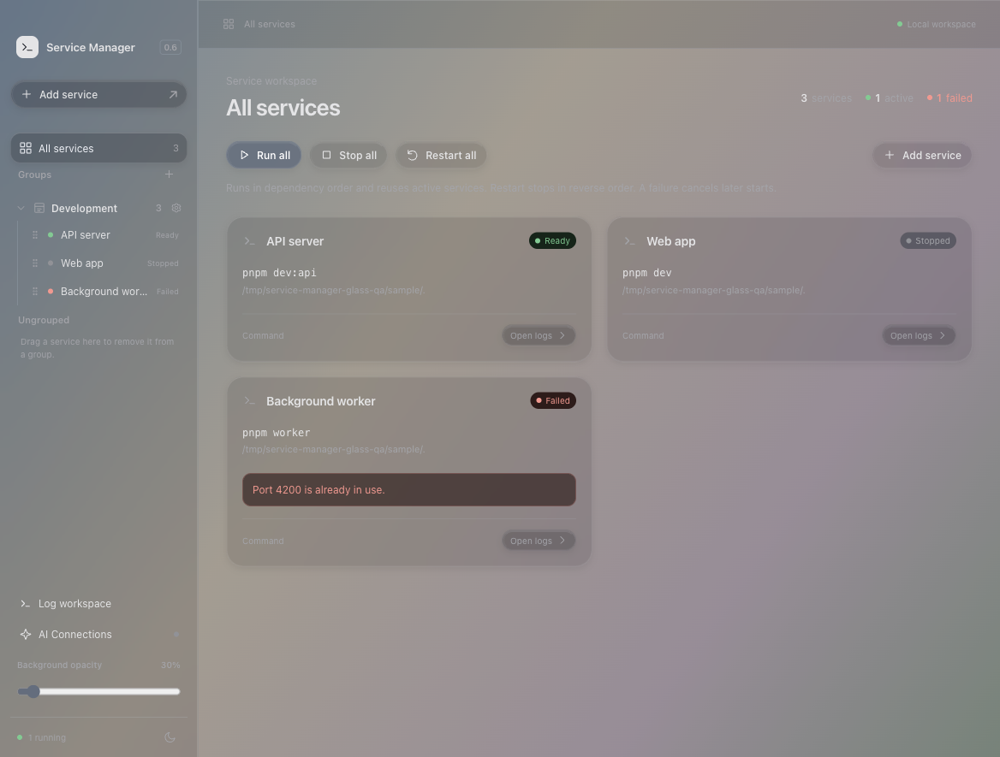
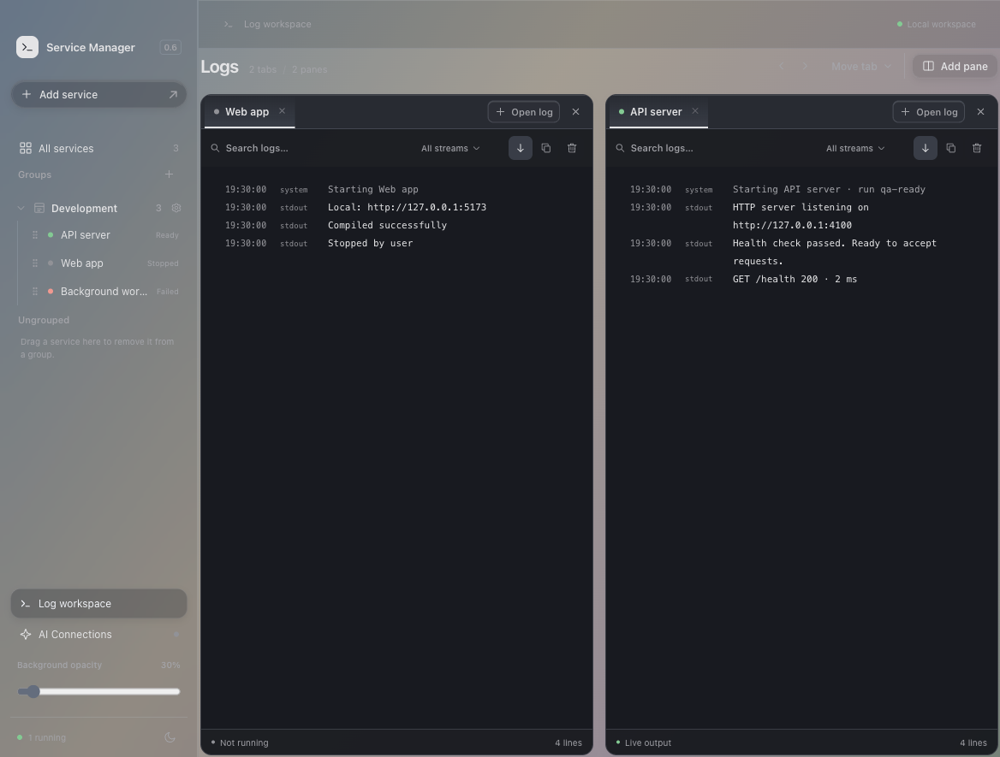

<p align="center">
  
</p>

<h1 align="center">Service Manager</h1>

<p align="center">Your local services, logs, and AI tools in one desktop workspace.</p>

<p align="center">
  <a href="#get-started">Get started</a> ·
  <a href="#log-workspace">Log workspace</a> ·
  <a href="#connect-codex-and-claude-code">AI connections</a> ·
  <a href="#development">Development</a>
</p>

Run Go, Node.js, and Docker Compose services without repeatedly typing commands. Organize them into groups, compare live logs, and let Codex or Claude Code use the same service manager through authenticated MCP or a generated log proxy.

**Current source version: 0.8.2.** Local development app built with **Tauri, Rust, React, and TypeScript**. macOS Apple Silicon is the verified desktop target; Windows builds are not yet verified. macOS builds are unsigned and not notarized. There are currently no published GitHub Release downloads.



*Screenshots use synthetic services and logs rendered by the actual React UI in an offline browser fixture. The backdrop illustrates the glass styling; native desktop translucency depends on macOS and accessibility settings.*

## What you can do

| Feature | Workflow |
| --- | --- |
| Services and groups | Save working folders and commands; drag services between virtual groups or Ungrouped. |
| Run / Stop / Restart | Control individual services or a whole group with dependency-aware ordering. |
| Readiness | Distinguish Starting, Running, Ready, and Failed; configure loopback health checks. |
| Port diagnostics | Inspect conflicting listeners before Run, with an explicit confirmed Kill action in the desktop app. |
| Open URL | Open a configured local service URL after reachability checks. |
| Log workspace | Open multiple tabs and panes, drag to rearrange them, and keep independent search, stream filters, and Follow settings. |
| History and failure alerts | Inspect bounded past runs and jump from a failure alert to the affected service. |
| AI access | Use authenticated MCP to inspect configuration, edit commands, control services, and read logs. |
| Diagnostic context | Preview/copy diagnostic context for Codex or Claude Code to analyze. |
| Liquid Glass | Native glass on supported macOS versions, light/dark appearance, and adjustable background opacity. |

## Get started

1. Build and launch the desktop app using the [development instructions](#development).
2. Choose **Add service**, select its working folder, and save a command or Docker Compose definition.
3. Review and approve the exact definition on its first desktop Run. Opening a folder never executes it automatically.
4. Create a group, then drag services into it. Choose **Run all** to start dependencies before their dependents.
5. Click a service for its full **Output**, **History**, **Diagnostics**, or **Settings** view.

For example, a single code folder can provide several services:

```text
my-app/
  backend/       → go run ./cmd/api
  frontend/      → pnpm dev
  compose.yaml   → Docker Compose service
```

Service definitions persist in `.service-manager/project.json` inside each registered working folder. Groups are virtual: moving or removing a group does not move or delete source code. Remove a stopped service through Settings to remove its definition while preserving its files.

Use foreground, noninteractive commands. Stop signals the owned process group, escalates after five seconds, and waits for cleanup. Running does not imply Ready: configure a health check when other services depend on readiness. Canceling a group sequence leaves services already started running.

See [service operations](docs/service-operations.md) for environment files, health checks, dependencies, port conflicts, history, and recovery.

## Log workspace



- **Drag a sidebar service onto the Log workspace button** to open its log tab immediately. An existing tab receives focus; the drop never starts the service or changes its group.
- Use **Open in log workspace**, overview **Open logs**, or a pane's **Open log** picker as alternatives.
- Add panes as needed. There is no fixed two-pane or tab-count limit.
- Drag tabs to reorder them, move them between panes, or create another pane. Keyboard controls provide the same operations.
- Search, stream filters, and Follow are independent per tab during the session. Only the layout and service references persist across launches.
- Closing a tab detaches its log observer; the service keeps running. Hidden/offscreen observers pause, and returning reports retention gaps when needed.

Clicking a sidebar service still opens its original full Output view. **Clear output** is a separate action that clears the manager's live buffer.

## Connect Codex and Claude Code

Open **AI Connections**, enable the loopback connection, and create a client profile. Copy the generated private configuration into your AI client's settings and reconnect the client.

The app exposes authenticated Streamable HTTP MCP at `http://127.0.0.1:47831/mcp`. Both MCP and the generated proxy share the desktop manager's processes and run identities.

- A valid token grants read, log, lifecycle, and command-edit access to **all registered services**, including services added later.
- Every valid token can create new empty project folders or open existing folders anywhere the app has OS access. No additional folder grants are needed, including for existing tokens. Creation does not generate framework code or initialize Git.
- The generated proxy lets an AI shell tool capture bounded log output directly in its tool response. It observes the managed service rather than launching a second manager.
- Logs are untrusted service output. A log proxy streams text; it does **not** forward HTTP/TCP ports or expose a preview remotely.

**Keep tokens and generated credentials private.** They authorize project creation/opening and command execution with your user permissions. Never commit them or include them in screenshots. Revocation and disabling AI Connections block subsequent access.

Install the included [Service Manager skill](docs/service-manager-skill.md) for the tool contract and log continuation workflow. Follow [AI connection setup](docs/ai-connections.md) for client configuration and proxy examples. Isolated Codex CLI integration was verified; Claude Code configuration is prepared, with its authenticated client check still pending login.

## Liquid Glass

The macOS window uses [tauri-plugin-liquid-glass 0.1.6](https://github.com/hkandala/tauri-plugin-liquid-glass) with native Clear glass on macOS 26+, and an NSVisualEffect blur fallback on older supported macOS versions. The sidebar opacity control persists a 30–100% setting. Text remains opaque; reduced-transparency and high-contrast preferences force opaque backgrounds.

The plugin uses private APIs, so future macOS compatibility and App Store suitability are not guaranteed. See [visual behavior](docs/service-operations.md#liquid-glass) and [third-party notices](THIRD_PARTY_NOTICES.md).

## Development

Requirements: macOS 13+ on Apple Silicon, Xcode command-line tools, Rust/Cargo, Node.js 22.16+, and pnpm 10.33.2. RTK is optional for contributors.

```sh
git clone https://github.com/Kit307/service-manager.git
cd service-manager
pnpm install --frozen-lockfile
pnpm tauri dev
```

Run the frontend checks:

```sh
pnpm test --run --maxWorkers=1
pnpm build
pnpm lint
```

Run the native checks and create a local app bundle:

```sh
cargo test --manifest-path src-tauri/Cargo.toml --no-default-features
cargo clippy --manifest-path src-tauri/Cargo.toml --all-targets -- -D warnings
pnpm tauri build --bundles app
```

The bundle is written under `src-tauri/target/release/bundle/`. For an isolated manual workspace, set `SERVICE_MANAGER_DATA_DIR` to a new private directory before launching the development app. Tests use synthetic commands and disposable roots; loopback tests need permission to bind local ports. Docker integration requires a running supported Docker context.

## Boundaries

Commands run with your user permissions; this app is not a sandbox for untrusted code. Deliberately detached children and abrupt app/OS termination are outside guaranteed cleanup. Closing the window hides it; Quit stops active services through the manager's cleanup flow.

Docker Compose support targets owned, foreground, single-container services on a local Unix-socket context. Stop never invokes `down`, prune, or volume removal. Unsupported Compose features and remote contexts are rejected; the app does not install tools, pull images, or build images automatically.

Live output and run history are bounded, not permanent log backups. Completed-run history retains at most 100 runs overall, 20 per service, and 64 KiB/500 records per run. Diagnostic redaction is best effort; review copied output before sharing. There is no built-in AI provider, automatic repair/restart, remote deployment, signing, notarization, or auto-update.

## Documentation

- [Service operations and log workspace](docs/service-operations.md)
- [AI connections and proxy setup](docs/ai-connections.md)
- [Install the Codex / Claude Code skill](docs/service-manager-skill.md)
- [Verification evidence and known limits](docs/verification.md)
- [Original architecture](docs/superpowers/specs/2026-10-16-service-manager-design.md)
- [Third-party notices](THIRD_PARTY_NOTICES.md)

## Shared Docker VPN (0.8.0)

Command services can select a saved OpenVPN profile and Linux runtime image. Multiple services share one tunnel, while separate profiles connect concurrently inside Docker without changing the Mac VPN. Configure private DNS, health targets and loopback port mappings on the Docker VPN page. See [setup and limitations](docs/docker-vpn.md).

This feature needs a local Docker engine and explicit image downloads. Certificate-only or username/password authentication with inline-certificate `.ovpn` files is supported. Encrypted inline keys can use a private saved key passphrase; OTP/SSO and automatic Compose conversion are outside this release. The installed app is upgraded separately from the source build.
